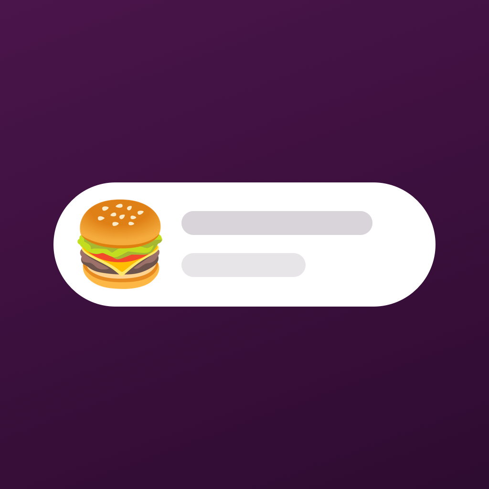
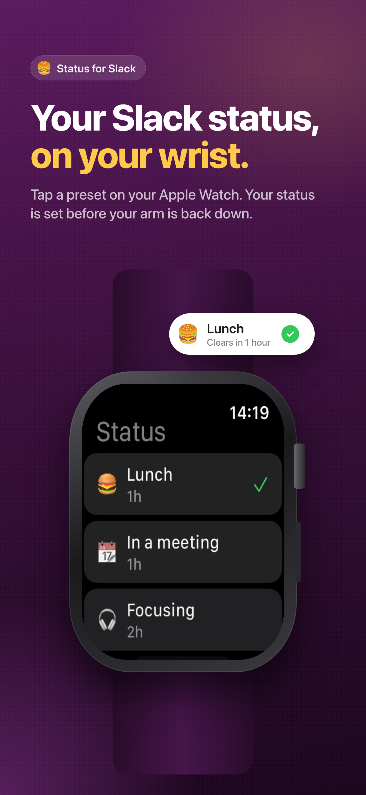
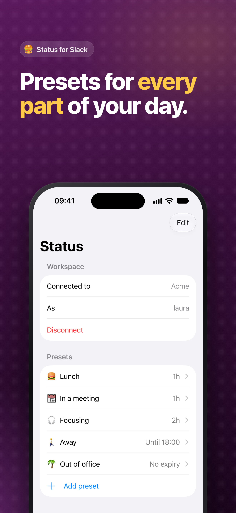
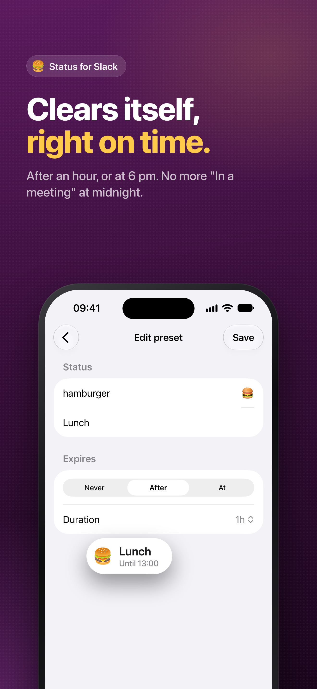
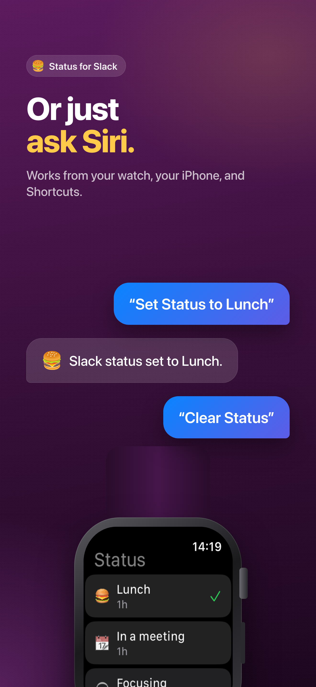
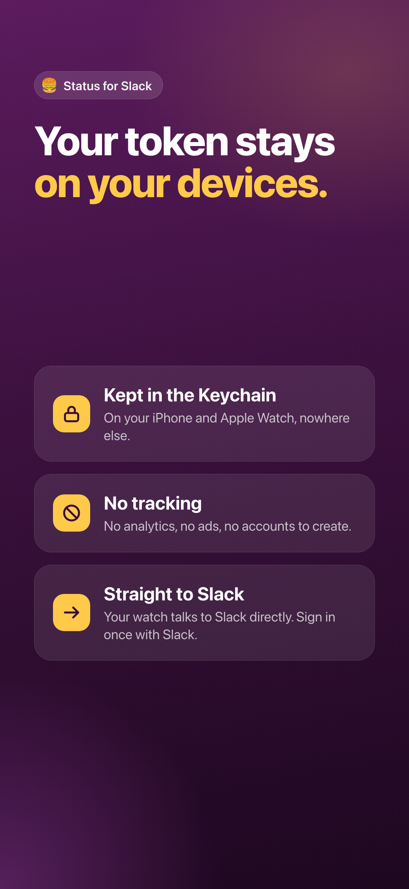

<p align="center">
  
</p>

<h1 align="center">Status for Slack</h1>

<p align="center">Set your Slack status from your Apple Watch. Tap a preset, done.</p>

<p align="center">
  
  
  
  
  
</p>

## What it does

- **Watch presets.** Tap Lunch, In a meeting, Focusing, Away or Out of office. A haptic confirms it and a checkmark marks the active one.
- **Expiry.** Each preset clears after a set time, from 15 minutes to 4 hours, or at a time of day.
- **Preset editor on the iPhone.** Pick any Slack emoji shortcode, write the text, reorder and delete. Changes sync to the watch.
- **Stays in sync.** The watch reads your current status when it opens, so a status set from Slack elsewhere shows up as "Current".
- **Siri and Shortcuts.** "Set Status to Lunch" and "Clear Status" work on both devices.
- **No backend accounts.** Sign in with Slack once. The token lives in the Keychain on the phone and the watch, and the watch calls Slack directly.

Requires iOS 27, watchOS 26 and Xcode 27.

## Layout

- `Packages/SlackStatusKit`: the Slack client, OAuth URL and callback parsing, presets, expiry math, the emoji table, and the Keychain and preset file stores. Tested with Swift Testing, no simulator needed:

  ```sh
  cd Packages/SlackStatusKit && swift test
  ```

- `Apps/Phone`: sign-in and the preset editor. Sends presets and the token to the watch over WatchConnectivity.
- `Apps/Watch`: the preset list that calls Slack directly.
- `Apps/Shared`: the App Intents for Siri and Shortcuts, built into both apps.
- `web`: a Vercel project with the OAuth callback function plus the privacy and support pages. The function swaps Slack's code for a user token using the client secret, then hands the token back on the `statusforslack://` scheme in the URL fragment, so it never lands in a server log or in the app binary.
- `AppStore`: screenshots, the slide designs they're rendered from, and the listing copy. See [AppStore/README.md](AppStore/README.md).
- `Status.xcodeproj` is generated from `project.yml` with [XcodeGen](https://github.com/yonaskolb/XcodeGen). Run `xcodegen` after adding files or changing settings.

## Setup

1. Create a Slack app at <https://api.slack.com/apps> from `slack-app-manifest.json`. Its redirect URL points at the Vercel deployment. To let other workspaces sign in, activate public distribution under Manage Distribution.
2. Deploy `web` to Vercel and set `SLACK_CLIENT_ID` and `SLACK_CLIENT_SECRET` from the Slack app's Basic Information page.
3. Set `SLACK_CLIENT_ID` and `SLACK_OAUTH_REDIRECT_URL` in `project.yml`, then run `xcodegen`. Quote the client ID so YAML keeps it a string.
4. Set `DEVELOPMENT_TEAM` in `project.yml` to your Apple team ID.
5. Run the `Status` scheme on your iPhone and tap Sign in with Slack. The watch app picks up the token the next time it's reachable.

Debug builds also offer "Use a token instead" for a pasted `xoxp-` User OAuth Token. Release builds leave it out.

Status for Slack is an independent app and is not made by or affiliated with Slack Technologies.
