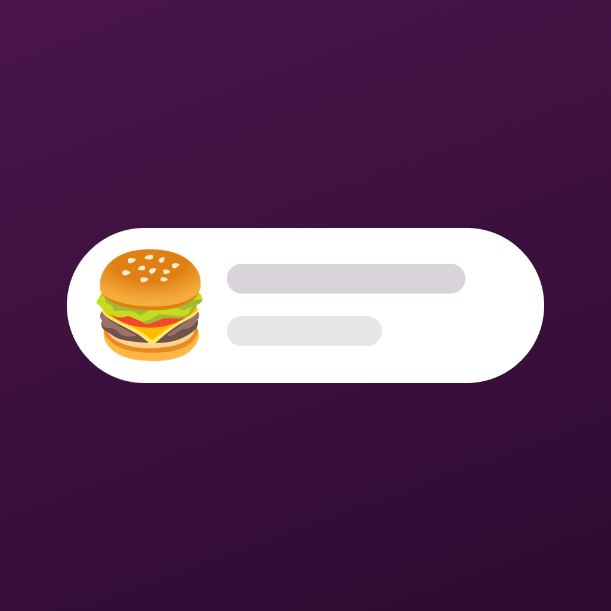
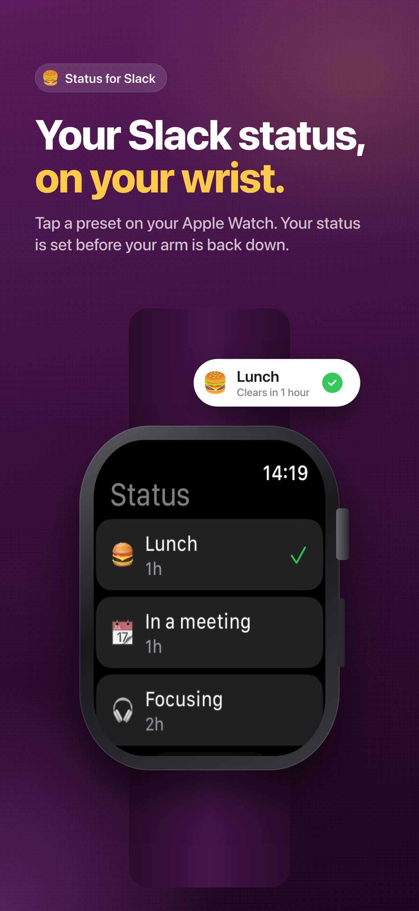
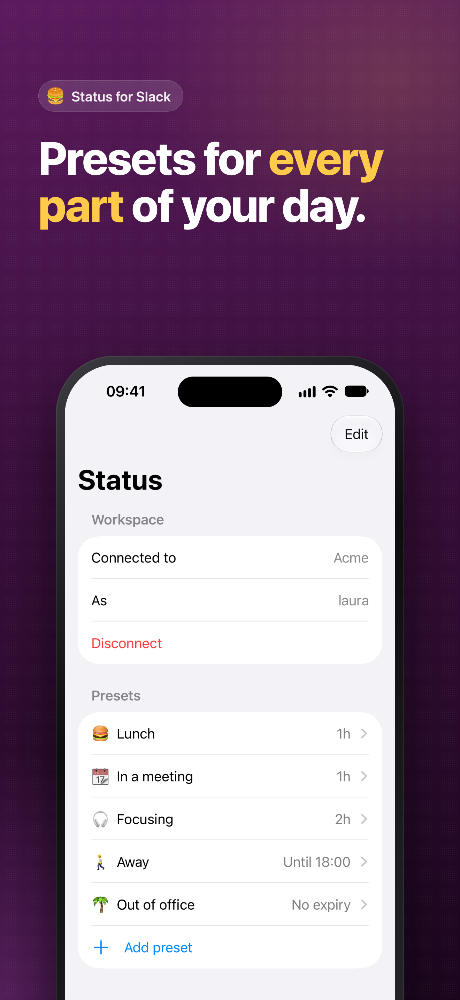
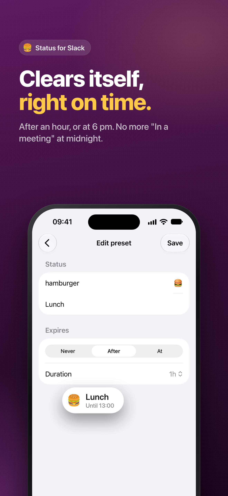
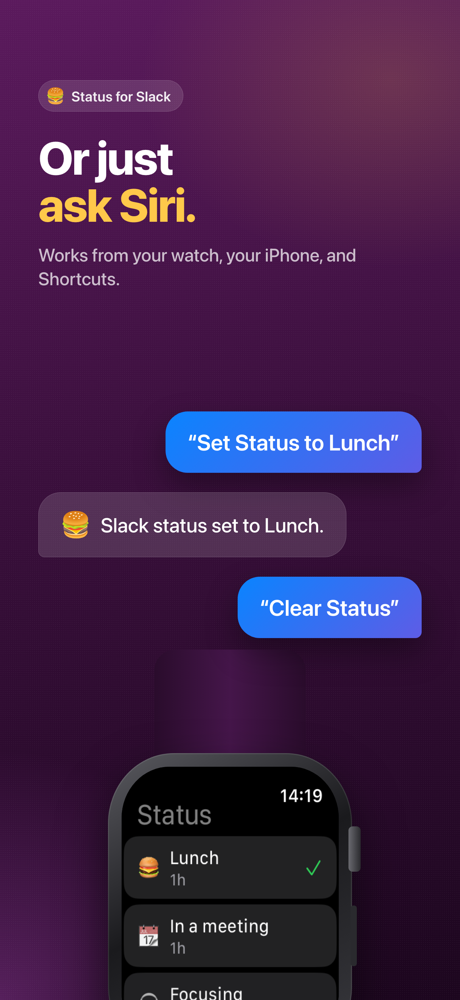
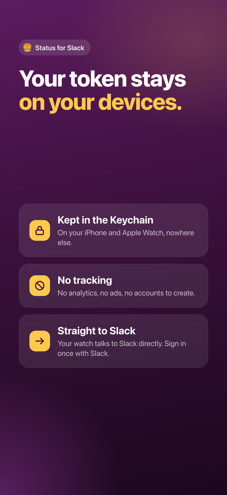

  

<h1 align="center">Status for Slack</h1>

Set your Slack status from your Apple Watch. Tap a preset, done.

  
  
  
  
  

Presets with an emoji, text and expiry are edited on the iPhone and tapped on the watch, which calls Slack directly. Siri and Shortcuts can set or clear a status on both. There's no backend account: the Slack token lives in the Keychain on each device.

Requires iOS 27, watchOS 26 and Xcode 27.

## Layout

- `Packages/SlackStatusKit`: the Slack client, OAuth, presets, expiry, emoji table and stores. Tests run without a simulator: `cd Packages/SlackStatusKit && swift test`.
- `Apps/Phone`: sign-in and the preset editor; syncs presets and the token to the watch.
- `Apps/Watch`: the preset list.
- `Apps/Shared`: the App Intents, built into both apps.
- `web`: the Vercel site. Its OAuth callback swaps Slack's code for a token and returns it in the URL fragment of a `statusforslack://` link, so it never reaches a server log or the app binary.
- `AppStore`: screenshots, their designs and the listing copy. See [AppStore/README.md](AppStore/README.md).
- `Status.xcodeproj` is generated by [XcodeGen](https://github.com/yonaskolb/XcodeGen) from `project.yml`. Run `xcodegen` after adding files or changing settings.

## Setup

1. Create a Slack app from `slack-app-manifest.json` at <https://api.slack.com/apps>. Activate public distribution to let other workspaces sign in.
2. Deploy `web` to Vercel with `SLACK_CLIENT_ID` and `SLACK_CLIENT_SECRET`.
3. In `project.yml`, set `SLACK_CLIENT_ID` (quoted), `SLACK_OAUTH_REDIRECT_URL` and `DEVELOPMENT_TEAM`, then run `xcodegen`.
4. Run the `Status` scheme on your iPhone and sign in. The watch gets the token the next time it's reachable.

Debug builds can also take a pasted `xoxp-` token. "Try the demo" runs against a sample workspace with no network calls; App Review uses it because Slack's sign-in emails a confirmation code.

Status for Slack is an independent app and is not made by or affiliated with Slack Technologies.
