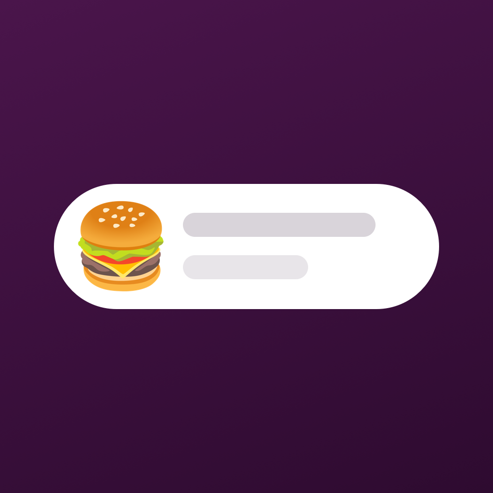

<p align="center">
  
</p>

<h1 align="center">Status for Slack</h1>

<p align="center">
  <b>Your Slack status, on your wrist.</b><br>
  Tap a preset on your Apple Watch. Your status is set before your arm is back down.
</p>

<p align="center">
  <a href="https://apps.apple.com/app/id6826875571">App Store</a> · <a href="https://www.wriststatus.com">Website</a>
</p>

## Development

Requires Xcode 27 and [XcodeGen](https://github.com/yonaskolb/XcodeGen).

```sh
xcodegen && open Status.xcodeproj
```

Run the package tests with `cd Packages/SlackStatusKit && swift test`.

To use your own Slack app, create it from `slack-app-manifest.json`, deploy `web/` to Vercel with `SLACK_CLIENT_ID`, `SLACK_CLIENT_SECRET`, `RESEND_API_KEY` and an Upstash Redis database (`KV_REST_API_URL`, `KV_REST_API_TOKEN`) for the install page's "Email me the link" (see [`web/emails`](web/emails)), and set the client ID, redirect URL and `DEVELOPMENT_TEAM` in `project.yml`.

<sub>Not made by or affiliated with Slack Technologies.</sub>
